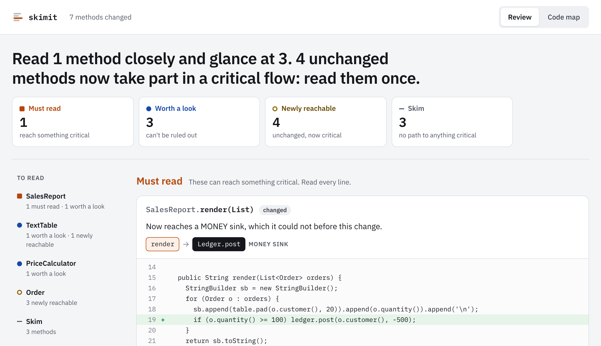

<p align="center">
  <picture>
    <source media="(prefers-color-scheme: dark)" srcset="docs/brand/banner-dark.svg">
    
  </picture>
</p>

<p align="center">
  <a href="https://github.com/PeterToulouras/skimit/actions/workflows/ci.yml"></a>
  <a href="https://github.com/PeterToulouras/skimit/releases/latest"></a>
  <a href="LICENSE"></a>
</p>

**skimit tells you which parts of a Java change need a careful review, which can be skimmed, and
proves it.** You list the few operations that are critical, in a file. It reads the compiled code
and works out what each change can reach.

- **Deterministic.** No model scores the diff. The same commit always gets the same answer.
- **Every verdict has a proof.** A flagged method comes with the chain of calls that connects it
  to something critical.
- **Checked against reality.** A recording agent compares the verdicts with what your tests
  actually run, and [the results are published](docs/experiment.md), misses included.

<p align="center">
  <picture>
    <source media="(prefers-color-scheme: dark)" srcset="docs/report-dark.png">
    
  </picture>
</p>

A one-line change inside a report class looks harmless in the text diff. In the call graph it is a
report that has started moving money, and skimit says so.

## Quick start

Download `skimit.jar` from the [latest release](https://github.com/PeterToulouras/skimit/releases/latest).
It needs Java 17 or newer.

**1. Say what is critical.** No code changes are needed: list it in a policy file. To start, use
[data-writes.policy](examples/policies/data-writes.policy), which treats every database write as
critical, then narrow it to what matters to you:

```
sink MONEY com.acme.billing.Ledger#post*
sink AUTH  com.acme.auth.Permissions#can*
```

If you would rather keep the marker next to the code, the optional `@Critical("MONEY")` annotation
does the same thing.

**2. Compare two builds:**

```
java -jar skimit.jar diff --base base/target/classes --head head/target/classes \
    --policy skimit.policy --html report.html
```

```
7 methods changed: 1 must review, 3 should review, 3 isolated.

Must review: on a critical path
- SalesReport.render(List) (changed) [MONEY] NEW PATH into MONEY
  - SalesReport.render(List) calls Ledger.post(String, long)
```

**3. Check it on your own tests:**

```
java -jar skimit.jar analyze target/classes --policy skimit.policy --agent-config agent.conf
mvn test "-DargLine=-javaagent:skimit-agent.jar=config=agent.conf,out=trace-%p.txt"
java -jar skimit.jar verify target/classes --policy skimit.policy --trace trace-1234.txt
```

To try it without your own code, clone the repository, run `mvn package`, then `./examples/demo.sh`.

## The three buckets

| Bucket | What it means | What to do |
|---|---|---|
| **Must review** | The method can reach something you marked critical. | Read it line by line. |
| **Should review** | It takes part in a critical flow, or cannot be proven clear. | Check it. |
| **Isolated** | Nothing connects it to anything critical. | Skim the body. |

Changes to class structure and public API are listed separately, so a senior reviewer can judge the
design without reading every body.

## Does it work?

Tested on 575 real commits from nine open-source projects, 21 security fixes, and six test suites,
with one fixed rule: every database write is critical.

- **33% of commits needed no body review**, and 39% touched a critical path.
- **Of 18 security fixes, 12 were flagged must review.** Four were called isolated: all in
  read-only code, which that rule does not cover.
- **The runtime check found 15 wrong verdicts** in a project skimit had never seen. They are fixed
  in 0.1.1.

Full write-up and raw data: [docs/experiment.md](docs/experiment.md).

## Documentation

- [Using skimit](docs/usage.md): commands, CI setup, policy files
- [How it works](docs/how-it-works.md): how a method gets its verdict
- [Evidence](docs/evidence.md): measurements on real codebases
- [Limits, roadmap and prior art](docs/limits.md): what the analysis does not see
- [Changelog](CHANGELOG.md)

## Contributing

Issues and pull requests are welcome; see [CONTRIBUTING.md](CONTRIBUTING.md). The most useful
thing to send is a small Java example where a verdict is wrong, in either direction.

## License

[MIT](LICENSE)
