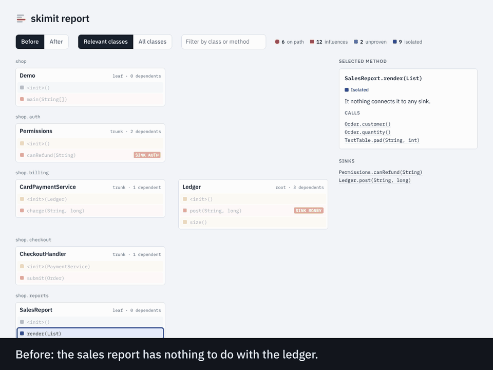

<picture>
  <source media="(prefers-color-scheme: dark)" srcset="docs/brand/banner-dark.svg">
  
</picture>

# skimit

Deterministic review manifests for Java, computed from bytecode: which changes need a careful
read, which you can skim, and the proof for each.

You mark the few places where something important happens (the ledger write, the permission
check). skimit works out, for every change, whether it can touch one of those places, and prints
the chain of calls that proves it. No model scores the diff: the same commit always gets the same
answer, and every answer comes with its reason.

**Status: 0.1.1.** The verdicts are not taken on trust. `skimit verify` records real runs and
compares them with the analysis, and an [experiment on 575 real commits, 21 security fixes and six
test suites](docs/experiment.md) reports where it was right and where it was wrong, with the data.
What is still outside the model is listed under [Known gaps](#known-gaps).



## What you get

For the pull request in `examples/`, which touches four files:

```
# Review manifest

7 methods changed: **1 must review**, 3 should review, 3 isolated.

## Must review: on a critical path

- `SalesReport.render(List)` (changed) [MONEY] **NEW PATH into MONEY**
  - can reach a critical sink
  - `SalesReport.render(List)` calls `Ledger.post(String, long)`

## Should review: takes part in a critical flow, or cannot be proven clear

- `PriceCalculator.total(Order)` (changed) [MONEY]
  - is called within a critical flow that starts at CheckoutHandler.submit(Order)
  - `CheckoutHandler.submit(Order)` calls `PriceCalculator.total(Order)`
- `SalesReport.<init>(Ledger)` (added) [MONEY]
  - writes a field read by SalesReport.render(List), which is part of a critical flow
  ...

## Shape changes: review the structure, not the bodies

- new public type CsvExport
- new dependency SalesReport -> Ledger (ROOT, 4 dependents)

## Isolated: nothing connects these to a sink, body review can be skipped

- `CsvExport.export(List)` (added)
```

The first entry is the case this tool exists for. In the text diff it is one added line inside a
report class. In the graph it is a report that has started moving money.

## Try it

Download `skimit.jar` from the [latest release](https://github.com/PeterToulouras/skimit/releases/latest)
(Java 17 or newer), or build it: `mvn package` puts it in `skimit-analyzer/target`, and
`./examples/demo.sh` then runs the whole thing on the example app.

On your own code:

```
# what is critical, and how much of the codebase is connected to it
java -jar skimit.jar analyze path/to/classes --list

# what a change needs: build the base and the head, then compare them
java -jar skimit.jar diff --base base/target/classes --head head/target/classes \
    --json manifest.json --exit-code
```

Add `--html report.html` to either command for the interactive map shown above: every method
coloured by verdict, the proof for whichever one you click, and for a diff the manifest beside it.
It is one self-contained file, so a CI job can attach it to the build.

Inputs are class directories or jars, as many as you like. `--exit-code` returns 1 when anything
lands in "must review" or a sink declaration changed, so a CI job can turn the result into a
required check.

### Check the verdicts on your own code

A static verdict is a claim. `skimit verify` tests it against what your program really does: run
your tests (or the application) with the recording agent, then compare.

```
java -jar skimit.jar analyze target/classes --policy your.policy --agent-config agent.conf
mvn test "-DargLine=-javaagent:skimit-agent.jar=config=agent.conf,out=trace-%p.txt"
java -jar skimit.jar verify target/classes --policy your.policy --trace trace-1234.txt
```

The agent notes every flow that reaches a sink: which methods were on the call stack at that
moment, and which had already run in the same flow (one request, when a servlet dispatch is
involved). `verify` fails if any of them is marked `ISOLATED`, or was on the stack without being
`ON_PATH`. A clean result covers what the run exercised and no more, so the better your tests
reach the critical code, the more it is worth.

## In CI

A sketch for GitHub Actions; adjust the build commands to your project. It builds the pull
request and its base, then writes the manifest to the job summary.

```yaml
- uses: actions/checkout@v4
  with: { path: head }
- uses: actions/checkout@v4
  with: { path: base, ref: ${{ github.event.pull_request.base.sha }} }
- run: mvn -q -f head/pom.xml -DskipTests package
- run: mvn -q -f base/pom.xml -DskipTests package
- run: |
    java -jar skimit.jar diff --base base/target/classes --head head/target/classes \
        --policy head/skimit.policy >> "$GITHUB_STEP_SUMMARY"
```

Keep the policy file under code-owner review: whoever can edit it decides what counts as
critical.

## Declaring what is critical

Either annotate the code (add the `skimit-annotations` jar, which has no dependencies):

```java
@Critical("MONEY")
public void post(String account, long cents) { ... }
```

or, for code you do not own, name it in a policy file passed with `--policy`:

```
sink   MONEY  com.acme.billing.Ledger#post*
sink   DATA   java.sql.*Statement#execute*
opaque com.acme.plugins.PluginBus#dispatch
store  settings write com.acme.settings.SettingsService#set*
store  settings read  com.acme.settings.SettingsService#get*
```

- `sink` adds a sink. Adding or removing one is reported as a policy change and always needs
  review.
- `opaque` names a call the analysis cannot follow, in addition to the built-in list (reflection,
  method handles, `ServiceLoader`, Spring event publishing and bean lookup, dispatch by URL).
- `store NAME write|read owner#method` declares state that outlives a request, such as a table or
  a cache that your own wrapper hides. Repositories, mappers, DAOs and the common database clients
  are recognised without it.
- `participant class|global annotation` names an annotation that makes a framework call a method
  inside flows it is not called from. The usual Spring, Jakarta and AspectJ ones are built in.

## How a method gets its verdict

Every method with a body gets exactly one, checked in this order.

| Verdict | Meaning | Rule |
|---|---|---|
| `ON_PATH` | It can reach a sink. | Backward over the call graph from each sink. |
| `INFLUENCES` | It takes part in a critical flow without reaching the sink. | Forward from on-path methods, by the six rules below. |
| `UNPROVEN` | No claim is made. | It can reach an opaque call, or a framework calls it at a time the analysis cannot see: a class that extends a library type and that only a framework constructs, a class with a stereotype annotation such as `@Component`, an aspect, an event listener. |
| `ISOLATED` | None of the above. | |

A method influences a critical flow when one of these holds, applied until nothing new is found:

1. **It is called from the flow.** Whatever a flagged method calls can hand it a value or throw
   into it. One exception: where a single call can land on several methods and one of them is on a
   path (a router calling one of many handlers), the others are alternatives to the critical
   branch and are left alone.
2. **It writes a field the flow reads.** Tracked per field and, for accesses on `this`, per object
   class. Reading a collection or array field counts as writing it, since a reader can change it.
3. **It writes a store the flow reads.** A repository, mapper, DAO, database client or declared
   store. This is how a settings screen that turns on automatic billing is tied to the billing
   job that reads the setting, though neither calls the other.
4. **It belongs to the data that reaches the sink.** The types handled by a sink and by its direct
   callers (in their signatures, field accesses, casts and allocations), and everything those
   objects hold in their fields, are flagged whole, because a framework may fill or read them by
   reflection. A class the caller only calls methods on is a collaborator, not data.
5. **The framework runs it alongside.** On the object of an on-path method: model attributes and
   binders before a request handler, lifecycle callbacks, injected setters.
6. **It wires the flow in.** A method that creates the lambda or method reference through which an
   on-path method is called.

Rules 3 to 5 exist because `skimit verify` showed real runs contradicting the analysis without
them.

The call graph analyses each instance method once per concrete class it can run on. A call on
`this` binds to that class alone, so a base-class method that calls an abstract hook reaches only
the hook of the subclass it is running in. A call on any other object may land on any concrete
subtype of its static type; that is why interface-typed dependency injection needs no knowledge
of the wiring. A lambda typed as one of your own interfaces is treated like any other
implementation of it: it is called where the interface is called. A lambda or object handed to a
library type is charged to the method that creates it, since the library may call it back.

Separately, every top-level class gets a position from the class dependency graph: `LEAF` when
nothing depends on it, `ROOT` when at least 10% of classes do (`--root-ratio`), `TRUNK` otherwise.
Position measures how far a bad abstraction would spread; the verdict measures what a bad body
could break. A diff reports position moves, new dependencies between classes and public API
changes in their own section, so a reviewer who cares about structure reads that list instead of
every body.

A change counts only if the method's bytecode changed. Comments, formatting, moved code and
renamed locals are not changes.

## How the verdicts are checked

Every number in this section and the next comes from an open-source project and can be re-run.
The full account, with what went wrong, is in [docs/experiment.md](docs/experiment.md); the raw
data is in [experiments/2026-10](experiments/2026-10).

### Against real runs

Each project's own test suite was run with the recording agent attached, test code included so
that a whole test counts as one flow. Every project used the same rule: any write through a
repository, mapper or DAO is a sink.

| Project | Seen during development | Tests | Sink calls | Methods in critical flows | Misses, 0.1.0 | Misses, 0.1.1 |
|---|---|---:|---:|---:|---:|---:|
| Spring PetClinic | yes | 79 | 22 | 76 | 0 | 0 |
| Spring Framework PetClinic | yes | 75 | 21 | 75 | 0 | 0 |
| JPetStore | yes | 98 | 49 | 82 | 0 | 0 |
| PetClinic REST | no | 237 | 93 | 178 | 0 | 0 |
| Apollo | no | 1,404 | 918 | 673 | 15 | 0 |
| JHipster sample app | no | 216 | 200 | 206 | 0 | 0 |

Apollo, the first large project to go through this check, showed 15 methods that 0.1.0 got wrong:
9 it had called isolated and 6 it had flagged but ranked too low. The causes were servlet filters
that hand on to the chain, a JPA converter, Spring's reflection helper, and an aspect's
constructor. Those gaps are closed in 0.1.1. The JHipster sample app was run only after the fixes,
and was clean.

This was the second round. Before 0.1.0, the same check on the three development projects found
twenty-three misses from four other gaps (methods Spring runs before a request handler, dispatch
by URL, components that code also constructs by hand, objects held by the data being saved), all
closed before release. Expect a framework skimit has not met to add to the list, and run
`skimit verify` on your own tests to find out.

### Against bug fixes and security fixes

- **Bug fixes.** `scripts/fix-check.py` takes the commits in the replay below that say they fix
  something (157 of 575) and asks of each method a fix changed in flagged code: when that method
  was last changed, how had the change been classified? Of 191 such methods with an earlier change
  in the replayed window, 96 had been "must review", 95 "should review" and none "isolated". This
  mostly shows the verdicts are stable; it would have caught a bad rule, it does not prove a good
  one.
- **Fixes in isolated code.** 30 of the 157 fix commits changed only isolated methods. Isolated
  means "cannot affect what the sinks are asked to do", not "cannot contain a bug".
- **Security fixes.** Of 18 real vulnerability fixes that still build, 12 were must review, 1
  should review, and 4 isolated. All four are in code that only reads, which a writes-only rule
  does not treat as critical: if reading something is sensitive, declare the read as a sink. One fix exposed
  a gap, now closed: a permission check called from a `@PreAuthorize` expression string.

## What the measurements say

### How much of a codebase is connected to its sinks

<picture>
  <source media="(prefers-color-scheme: dark)" srcset="docs/verdicts-dark.svg">
  
</picture>

| Codebase | Sinks | Methods | On path | Influences | Unproven | Isolated |
|---|---|---:|---:|---:|---:|---:|
| [Spring PetClinic](https://github.com/spring-projects/spring-petclinic) | repository saves | 116 | 5.2% | 57.8% | 12.9% | 24.1% |
| [Spring Framework PetClinic](https://github.com/spring-petclinic/spring-framework-petclinic) | repository saves | 179 | 7.8% | 69.3% | 6.1% | 16.8% |
| [JPetStore](https://github.com/mybatis/jpetstore-6) | placing an order | 248 | 1.6% | 63.3% | 1.2% | 33.9% |
| [XXL-JOB](https://github.com/xuxueli/xxl-job), core and admin | running or killing a job on an executor | 928 | 2.2% | 66.3% | 2.4% | 29.2% |
| Broadleaf Commerce 3.1.15, framework and common | payment gateway transactions | 7,785 | 1.6% | 62.3% | 15.3% | 20.8% |
| Kill Bill 0.25.4, thirteen modules | payment plugin calls that move money | 10,002 | 2.7% | 68.4% | 18.6% | 10.3% |

The sinks behind this table are one reasonable choice per project, in
[examples/policies](examples/policies). Shares are of methods with a body. The two largest were analysed from their published jars; the
largest run takes under ten seconds.

- **The top tier is small and exact.** Between 1.6% and 7.8% of methods can reach a sink: 124 of
  7,785 in Broadleaf, 271 of 10,002 in Kill Bill. Each comes with a proof. No path-based or
  score-based tool produces that list.
- **A tenth to a third is isolated.** Before the verdicts were checked against real runs these
  shares were about fifteen points higher; the difference is code the earlier rules wrongly
  cleared. A smaller number that survives checking is worth more than a larger one that does not.
- **It depends on what the product is.** Kill Bill is a billing platform: most of it exists to
  decide what gets charged, and a tenth is isolated. That is the honest answer for such a
  codebase.

### What real commits needed

<picture>
  <source media="(prefers-color-scheme: dark)" srcset="docs/replay-dark.svg">
  
</picture>

`scripts/replay.sh` checks out each recent commit that touches main Java sources, builds it and
its parent, and runs `skimit diff` between the two. Run over nine projects' histories with one
rule for all of them (any write through a repository, mapper or DAO is a sink):

| Project | Commits analysed | No code change | Isolated only | Should review | Must review |
|---|---:|---:|---:|---:|---:|
| XXL-JOB | 195 | 32 | 11 | 55 | 97 |
| Spring PetClinic | 84 | 31 | 14 | 20 | 19 |
| PetClinic REST | 78 | 12 | 12 | 23 | 31 |
| Apollo | 68 | 1 | 14 | 25 | 28 |
| litemall | 45 | 4 | 18 | 4 | 19 |
| newbee-mall | 37 | 4 | 8 | 9 | 16 |
| Spring Framework PetClinic | 26 | 5 | 4 | 13 | 4 |
| JPetStore | 22 | 13 | 0 | 6 | 3 |
| vhr | 20 | 2 | 2 | 8 | 8 |
| **Total** | **575** | **104** | **83** | **163** | **225** |

- **33% of commits needed no body review** (187 of 575): either nothing in the bytecode changed
  (comments, formatting, renamed locals) or every changed method was isolated.
- **39% contained something on a critical path** (225 of 575), and the manifest says which methods
  and why. The remaining 28% touched code that takes part in a critical flow without reaching the
  sink.
- **The projects differ a lot**, from 20% needing no body review (vhr) to 59% (JPetStore).

Limits of this data: 183 of the 758 commits tried no longer build, mostly older ones whose
dependencies have disappeared, so the samples lean recent. "Every database write" is a blunt rule,
not the maintainers' own choice of what matters; narrower sinks leave more code isolated. The
replay on your own history, with your own sinks, is the number that matters:

```
scripts/replay.sh path/to/your/repo your.policy 100
scripts/fix-check.py path/to/your/repo path/to/your/repo-replay
```

## Known gaps

What the model still leaves out. `skimit verify` will show you whether any of these bite on your
code.

- **Stores are coarse.** A repository or mapper is one store. A raw database client (JDBC, an
  `EntityManager`, a DynamoDB client) is one store for the whole program, so every writer through
  it influences every critical reader. Declare `store` lines for the tables that matter if that
  flags too much. State kept somewhere unrecognised (a file, a message queue, another service) is
  not modelled unless you declare it.
- **A writer's callers.** The method that performs a write is flagged; a caller that only passes
  it a value is flagged when the flow reaches it by a call, not otherwise.
- **Guards.** A permission check is a sink like any other: its callers are on a path. Whether each
  caller uses the answer correctly is not checked.
- **Alternatives in a loop.** Where one call can land on several methods, the ones not on a path
  are treated as alternatives. A loop that calls several of them in turn (a listener list) lets an
  earlier one throw before a later one runs; that is missed.
- **Changes through a reference.** A method that mutates an object it got from a field is caught
  only when the field is a collection or array.
- **Frameworks beyond the built-in list.** Spring MVC, Jakarta lifecycle and AspectJ annotations
  are known. Another framework's equivalents need `participant` lines.
- **Library types behind library types.** The hierarchy is known only for the classes you pass in.
  A class that implements a library interface is not matched to calls made through that
  interface's own parents.
- **Flows that leave the process.** A call to another service is not a sink unless you declare
  it. Code that guards or prepares such a call is isolated until you do.
- **Expressions in strings.** A bean method named in an annotation expression
  (`@PreAuthorize("@rules.canEdit(#id)")`) is followed. Other expression languages, templates and
  configuration files that name methods are not.
- **Reflection by another name.** Opaque calls are matched by a list. A reflective path through a
  library that is not on the list is invisible.
- **Lambda numbering.** Adding a lambda can renumber the ones after it in the same class, which
  shows up as extra changed methods.
- **Kotlin, Scala, Groovy.** They compile to bytecode and should load, but nothing has been tested.

## Roadmap

1. Tell tables apart behind a raw database client, from the SQL or the request it is given.
2. Replace the call rule with a backward data-flow slice from the sink's arguments, so that a
   helper called after the critical call stops counting.
3. Read Spring's ahead-of-time output and bean metadata to turn framework wiring into ordinary
   edges.
4. Accept a library classpath for hierarchy only.
5. A GitHub Action that builds base and head, posts the manifest as a pull request comment and
   sets a status.
6. Serve the same verdicts to editors through a language server.

## Prior art

- Error Prone's `@RestrictedApi`, Rust's `unsafe`, Kotlin's `@RequiresOptIn`: compiler-enforced
  markers at the call site. skimit derives the reach of a marker instead of requiring one per
  caller.
- Google's Safe Coding work: keep risky operations inside a few expert-reviewed abstractions and
  let the type checker cover the rest.
- Meta's Diff Risk Score and RADAR, and similar risk-tiering in other review tools: the same goal,
  reached with learned scores over the diff.
- WALA, Soot and OPAL (call graphs from bytecode), CodeQL and Doop (facts and queries), ArchUnit
  (architecture rules as tests): the machinery this builds on in spirit.
- DO-178C and ISO 26262: criticality levels assigned to components, with rigor scaled to match.

## Brand

Logo, wordmark and social preview are in [docs/brand](docs/brand). The mark is four lines of text
with one picked out: the line you have to read. The four verdict colours are checked for
colour-blind separation in both themes, and the report never relies on colour alone.

## Contributing

Issues and pull requests are welcome; see [CONTRIBUTING.md](CONTRIBUTING.md). The most useful
thing you can send is a small Java example where a verdict is wrong, in either direction.

## License

MIT
