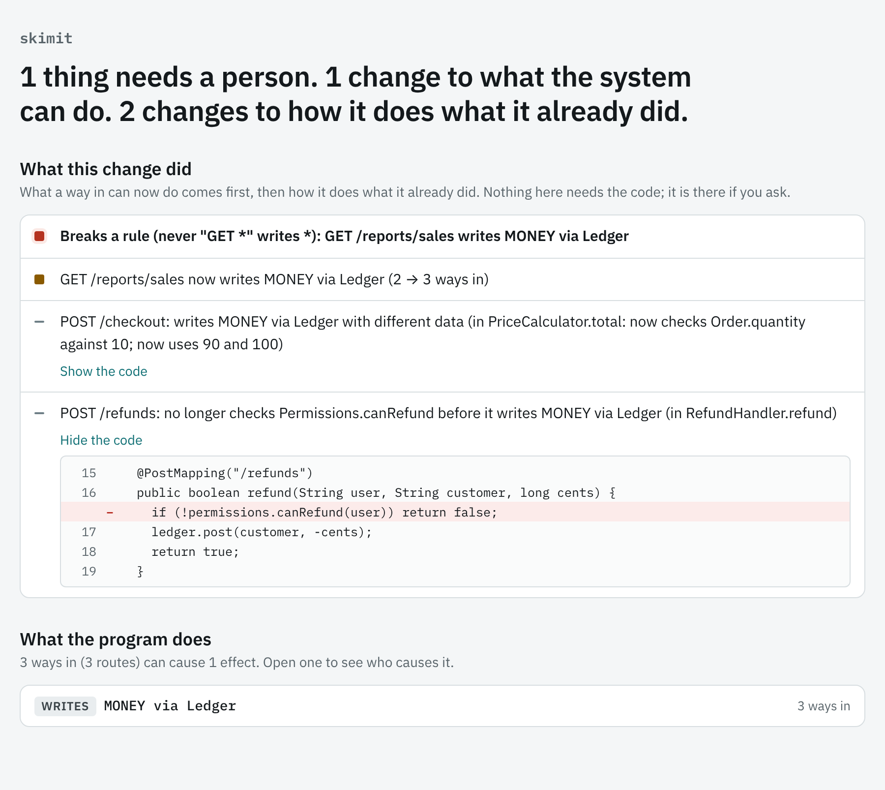

<p align="center">
  <picture>
    <source media="(prefers-color-scheme: dark)" srcset="docs/brand/banner-dark.svg">
    
  </picture>
</p>

<p align="center">
  <a href="https://github.com/PeterToulouras/skimit/actions/workflows/ci.yml"></a>
  <a href="https://github.com/PeterToulouras/skimit/releases/latest"></a>
  <a href="LICENSE"></a>
</p>

**skimit tells you what your Java service does, and what each change did to that, without
anyone reading the code.** It reads the compiled code before and after a change and answers in a
few lines: which routes, jobs and listeners can now write, delete, call out or send something they
could not before, which changed how they do it, and which rules your team set the change breaks.

- **Behaviour, not code.** A line names a way in and an effect: `POST /refunds: no longer checks
  Permissions.canRefund before it writes MONEY via Ledger`. Moved classes, renamed methods and
  reformatted code say nothing, because they change nothing a way in does.
- **Sized for a person.** One sentence first, seven lines at most before the rest folds away, and
  the code behind a line only when you ask for it.
- **Deterministic and checked.** No model scores anything; the same commit always gets the same
  answer. A recording agent checks the map against what your tests really do.

<p align="center">
  <picture>
    <source media="(prefers-color-scheme: dark)" srcset="docs/page-dark.png">
    
  </picture>
</p>

## Quick start

Download `skimit.jar` from the [latest release](https://github.com/PeterToulouras/skimit/releases/latest)
(Java 17 or newer), build your code before and after a change, and compare the two:

```
java -jar skimit.jar diff --base base/target/classes --head head/target/classes --html skimit.html
```

With Gradle, point it at `build/classes/java/main` instead. For the example pull request in this
repository, with the example shop's one rule (`never "GET *" writes *`, passed with `--policy`), it
prints:

```
## skimit: 1 thing needs a person. 1 change to what the system can do. 2 changes to how it does what it already did.

- **Breaks a rule (never "GET *" writes *): GET /reports/sales writes MONEY via Ledger**
- GET /reports/sales now writes MONEY via Ledger (2 → 3 ways in)
- POST /refunds: no longer checks Permissions.canRefund before it writes MONEY via Ledger (in RefundHandler.refund)
- POST /checkout: writes MONEY via Ledger with different data (in PriceCalculator.total: now checks Order.quantity against 10; now uses 90 and 100)
```

The same pull request also tidies a text helper. That changes nothing a route does, so it is not
mentioned.

To see what a program does at all, `map` lists its effects and who can cause each:

```
java -jar skimit.jar map target/classes
```

No annotations and no configuration are needed for a first run. Out of the box, the effects are
data written or deleted through your repositories, mappers and DAOs or a common database client,
calls to other services over HTTP or through a generated client, and messages and email sent.

### Set rules

A policy file says what your team decided, in terms of behaviour, and every change is checked
against it:

```
never "GET *" writes *            # a read route never writes
only  OrderService writes Order   # every way to write Order goes through OrderService
review deletes *                  # a new way to delete data needs a person
```

```
java -jar skimit.jar diff --base ... --head ... --policy skimit.policy --exit-code
```

The same file can name your own effects, `sink MONEY com.acme.billing.Ledger#post*`, for anything
the built-in rule does not cover.

### Check it against your tests

The map is a claim. This runs your tests with a recording agent and reports anything the run did
that the map says it cannot:

```
java -jar skimit.jar map target/classes --agent-config agent.conf
mvn test "-DargLine=-javaagent:skimit-agent.jar=config=agent.conf,out=trace-%p.txt"
java -jar skimit.jar verify target/classes --trace trace-1234.txt
```

To try it all without your own code, clone the repository, run `mvn package`, then
`./examples/demo.sh`.

## In CI

Add it to a GitHub workflow and every pull request gets the result in its job summary:

```yaml
- uses: actions/checkout@v7
  with: { persist-credentials: false }
- uses: actions/setup-java@v6
  with: { distribution: temurin, java-version: 21 }
- uses: PeterToulouras/skimit@v1
  with:
    policy: skimit.policy
```

It only reports unless you ask it to fail the job on a broken rule or comment on the pull request;
see [docs/usage.md](docs/usage.md#in-ci). Workflows on `@v0` keep the 0.1 review manifest.

## Does it work?

Replayed over 580 real commits from nine open-source Java projects, with no configuration, by a
workflow anyone can re-run:

- **65% changed nothing a way in does** (refactoring, renames, logging, read paths), and skimit
  said so in one line. **9% changed what the system can do**, and **27% changed how it does what
  it already did**.
- **It fits on a screen**: the median commit with something to say needed 2 lines, and 87% needed
  no more than 7.
- **Checked against six projects' test suites** (2,109 tests): no run did anything the map says
  it cannot.
- **Checked against known changes**: of 26 edits injected into the example shop and 18 into
  PetClinic REST, all 26 that change behaviour are said, and 10 of the 16 that only change the
  code are silent. Each of the other six is listed, with what skimit said.
- **Sixty of the replayed commits read by hand**: of 30 skimit said nothing about, 22 changed
  nothing a reviewer needed and 6 had, 4 of them checks that guard reads, which are outside what
  skimit sees. Of 30 with lines about how, 17 were what a reviewer needed, 7 were wrong and are
  fixed, 6 were true of the bytecode and useless.

Full numbers and how to re-run them: [docs/evidence.md](docs/evidence.md).

## Documentation

- [Using skimit](docs/usage.md): commands, rules, CI setup
- [How it works](docs/how-it-works.md): ways in, effects, and what a change did
- [Evidence](docs/evidence.md): measurements on real codebases
- [Limits, roadmap and prior art](docs/limits.md): what the analysis does not see
- [Changelog](CHANGELOG.md)

## Contributing

Issues and pull requests are welcome; see [CONTRIBUTING.md](CONTRIBUTING.md). The most useful
thing to send is a small Java example where skimit missed an effect or said something nobody
needed.

## License

[MIT](LICENSE)
